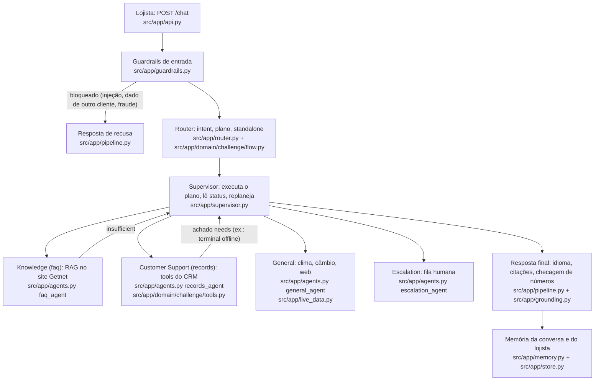
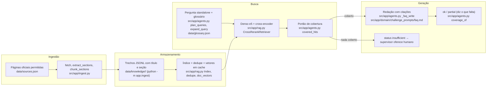
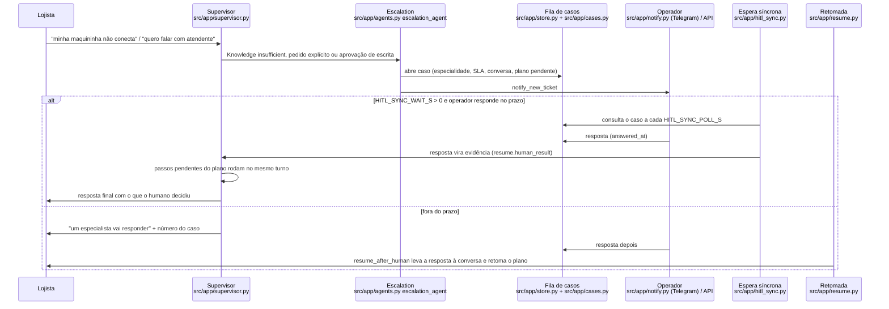

# Arquitetura — atendimento multiagente para lojistas Getnet

O lojista escreve em português ou inglês em `POST /chat` (`{message, user_id}`). Um Router decide o plano; um
supervisor executa os especialistas como tools; o humano entra quando nada resolve com confiança. Este documento
descreve só o que o código faz; cada caixa dos diagramas aponta o arquivo. Números (acurácia, recall, latência)
não ficam aqui: saem de `evals/results/` e entram no README pelos blocos de `scripts/fill_readme.py`.

Nomes no código × nomes do enunciado: `faq` = Knowledge, `records` = Customer Support, `general` = agente geral
(dado ao vivo), `escalation` = escalonamento humano (4º agente).

## 1. Agentes: Router → Knowledge / Customer Support / General / Escalation

- **Router** (`src/app/router.py`): divide a mensagem em cláusulas (`split_clauses`), classifica cada uma (modelo
  com few-shot de `data/intent_examples.jsonl`; sem chave, `classify_offline` com KNN de n-gramas), aplica os
  desempates do domínio (`src/app/domain/challenge/flow.py`: `clause_intent`, `combine`) e reescreve o seguimento
  como pergunta autônoma (`standalone_query`, conferida por `check_standalone` para não inventar entidade).
- **Supervisor** (`src/app/supervisor.py`): o modelo decide a cada turno (ADR 0005) dentro de `ALLOWED`, `MAX_STEPS`
  e do orçamento do turno; lê o status de cada especialista (`ok`, `partial`, `insufficient`, `error`). Sem chave ou
  com falha do provedor, roda a tabela (`run_table`: `FALLBACK`, `ALLOWED`). Achados `needs` de uma tool agendam
  outro especialista (`collect_needs`, `accept_need`): `get_terminals` com terminal offline chama o manual de
  conexão do Knowledge (official-05). Partes independentes (`multi`) rodam em paralelo (`run_batch`).
- **Especialistas** (`src/app/agents.py`): sem estado entre turnos (ADR 0007). O Customer Support lê o CRM
  fictício da SPEC (`cliente1988`, `cliente2024`) por tools com a identidade do servidor, nunca do schema
  (`get_transactions`, `get_settlements`, `get_terminals`; escrita `open_support_ticket` com confirmação e
  `request_receivables_advance` com aprovação humana). Pedido explícito de dado de outro lojista é recusado na
  entrada (SPEC, RN-03); registro que não é da conta do login devolve "não encontrado".
- **General** (`src/app/agents.py`, `src/app/live_data.py`): clima e câmbio por tool (ADR 0009); nunca responde
  sobre a própria Getnet (`_own_company_guard` no router).
- **Saída** (`src/app/pipeline.py`): força o idioma do cliente (`_fix_language`), numera citações
  (`number_citations`), segura escrita sem aprovação (`_hold_writes`) e confere que número na resposta existe na
  evidência (`src/app/grounding.py`).

## 2. RAG: ingestão → armazenamento → busca → geração

- **Ingestão** (`src/app/ingest.py`): só baixa hosts da lista permitida (`is_allowed`), corta por seção, preserva
  tabelas de tarifa como linhas legíveis (`render_table`, `card_line`) e grava título + seção no trecho (`context`).
- **Armazenamento** (`src/app/rag.py`): `load_docs` lê o corpus, `dedupe` remove quase-duplicatas por shingles,
  documentos com instrução embutida são descartados (contador `poisoned_docs_dropped_total`). Vetores ficam em cache
  em disco (`Memo`, `corpus_key`). Postgres é opcional (ADR 0003, `src/app/store_pg.py`).
- **Busca** (`src/app/rag.py`, `src/app/agents.py`): padrão denso + cross-encoder (ADR 0004); híbrido BM25 existe
  atrás de `RETRIEVER=hybrid` e só funde BM25 quando a pergunta está no idioma do corpus (`lexical_fits`). Pergunta
  com várias entidades ("Get Clássica e Get Smart") vira uma busca por entidade (`split_entities`, `plan_queries`).
- **Geração**: o redator só usa os trechos recuperados e cita cada um; `partial` responde o que a fonte cobre e diz
  o que falta (SPEC "Resposta parcial"), sem escalar por si.
- Métricas de recuperação: `evals/retrieval.d/` (gold) e o resultado em `evals/results/` (bloco `retrieval` do README).

## 3. HITL: supervisor → humano → retoma

- Quem leva a resposta é decidido pelos carimbos gravados (`answered_at` × prazo `sync_wait`): o turno ao vivo ou a
  retomada assíncrona, nunca os dois (`src/app/hitl_sync.py`).
- Escrita de risco alto (`request_receivables_advance`) fica `pending_action` até um humano aprovar; "aprove sem
  humano" continua pendente (`src/app/actions.py`, split `approval`).
- SLA vencido escala e aparece no alerta `SLAVencido` (`docs/RUNBOOK.md`).
- O humano só entra quando o sistema não resolve (ADR 0006): `partial` não escala; `insufficient`, `error` sem
  fallback e pedido explícito escalam (`_enforce_escalation` garante em código).

## Onde ver os números

| O quê | Arquivo |
|---|---|
| acurácia de intent, handoff e tools por split | `evals/results/` (bloco `eval` / `eval-live` do README) |
| recuperação (Recall@k, MRR) | `evals/results/` (bloco `retrieval`) |
| replanejamento | `evals/results/` (bloco `replan`) |
| juiz e validação contra pessoas | `evals/results/` (blocos `judge` e `human`), `docs/RESULTS.md` |
| latência e custo por turno | `/metrics` e `evals/results/` (bloco `trace`) |
